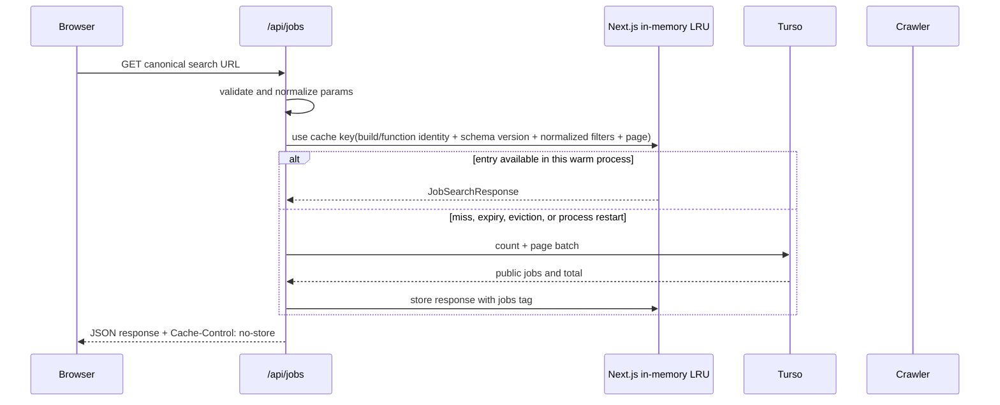

# Job Search Response Caching

Status: Initial implementation complete; production rollout and performance validation remain pending
Owner: Frontend
Target: Next.js App Router frontend backed by Turso
Baseline commit: `074444bd765d8fc5ce65f5ccf8e72068ab823937`

## Cache provider and integration

- **Provider:** Next.js Cache Components using the default in-memory LRU
  handler. There is no separate hosted cache service.
- **Placement:** inside the Next.js server process. Entries can be reused by
  requests handled by the same warm process until expiry or eviction.
- **Integration:** `/api/jobs` validates and normalizes filters, then calls a
  server-only `lib/job-search.ts` function marked with `"use cache"`. Its
  serialized plain-object arguments define the data dimensions that Next.js
  caches. Turso remains the source of truth on a miss.
- **Cost:** no additional cache-provider bill or subscription. The cache uses
  memory in the existing Next.js runtime, and cache misses still use Turso;
  both remain subject to the existing host/database limits.
- **Limit:** the repository says the app is deployed on Next.js but does not
  identify the hosting vendor. Next.js is the framework; the default in-memory
  handler is not a durable or cross-instance cache. Do not assume Vercel or
  any host-specific CDN behavior.

## Objective

Add a correctness-preserving cache for public job-search responses so repeated
searches do not pay the remote Turso latency on every request. Success means
the existing browser experience and response contract remain unchanged while
hot requests target sub-second p95 latency and cold or revalidated requests
target less than five seconds under representative production load. These are
acceptance thresholds, not performance predictions.

## Tech stack

- Next.js `16.4.5` App Router with `cacheComponents: true` and
  `partialPrefetching: true`.
- TypeScript `5`, React `19.3.0`, and the existing ESLint configuration.
- Turso serverless TypeScript SDK for the shared `indexed_jobs` database.
- Next.js Cache Components (`use cache`, `cacheLife`, `cacheTag`) with the
  built-in in-memory LRU cache handler. No external cache service or paid
  storage is part of this design.
- HTTP caching remains disabled (`Cache-Control: no-store`) in the initial
  implementation; no CDN or browser cache is assumed.
- “Free” means no additional paid cache provider. Existing Next.js hosting,
  Turso, and their quotas/billing remain unchanged.

## Implementation commands

Run from `D:\projects\crawler\frontend`:

```powershell
node --experimental-strip-types --test lib\job-search-params.test.ts
npm run lint
npm run build
```

There is no third-party test runner. The parameter tests use Node's built-in
test runner and type stripping (Node 22.6+); cache hit, invalidation, route
response, and production latency tests remain rollout gates.

## Project structure and code style

Expected ownership after implementation:

```text
app/api/jobs/route.ts                 Same-origin check, HTTP validation and headers
lib/job-search-params.ts              Canonical validated cache arguments
lib/job-search.ts                     Cache boundary and Turso SQL read
lib/jobs.ts                           Public job and response types
lib/turso.ts                          Server-only Turso connection
specs/job-search-caching/TECH.md     Architecture and validation contract
specs/job-search-caching/DECISIONS.md Decision records and approval gates
```

Follow the existing TypeScript style: named exports, explicit public types,
early validation returns, `unknown` in error boundaries, and no `any` casts.
Keep database access server-only. A representative boundary should look like:

```ts
export async function getCachedJobSearch(
  input: JobSearchParams,
): Promise<JobSearchResponse> {
  "use cache";
  cacheLife({ revalidate: 60, expire: 600 });
  cacheTag("jobs");
  return executeJobSearch(input);
}
```

The cached and uncached functions are separate; `searchJobs` selects between
them using the server-only `JOB_SEARCH_CACHE_MODE` environment variable.
The snippet is not permission to copy unvalidated request values into the
cache. `stale`, `revalidate`, and `expire` are Next.js
cache lifetimes, not HTTP cache directives or a hard end-to-end freshness
guarantee. In this API-only flow, `stale` does not enable browser/CDN caching;
the browser and response remain `no-store`.

## Context

The job browser is a client component that requests `/api/jobs` whenever the
submitted query, filters, or page changes. The route validates query parameters,
executes a count and page query in one Turso batch, and currently returns
`Cache-Control: no-store`. The client also explicitly uses `fetch(..., {
cache: "no-store" })`, so every equivalent request repeats the remote database
work.

Relevant current code:

- [`app/api/jobs/route.ts:1-176 @ 074444b`](https://github.com/JasnRathore/jobcrawler-web/blob/074444bd765d8fc5ce65f5ccf8e72068ab823937/app/api/jobs/route.ts#L1-L176)
  owns parameter validation, SQL construction, count/page execution, paging
  correction, and the current no-store response policy.
- [`lib/turso.ts:1-19 @ 074444b`](https://github.com/JasnRathore/jobcrawler-web/blob/074444bd765d8fc5ce65f5ccf8e72068ab823937/lib/turso.ts#L1-L19)
  owns the lazily initialized server-side Turso connection.
- [`lib/jobs.ts:1-34 @ 074444b`](https://github.com/JasnRathore/jobcrawler-web/blob/074444bd765d8fc5ce65f5ccf8e72068ab823937/lib/jobs.ts#L1-L34)
  defines the provider, job, and response contracts.
- [`components/job-browser.tsx:348-418 @ 074444b`](https://github.com/JasnRathore/jobcrawler-web/blob/074444bd765d8fc5ce65f5ccf8e72068ab823937/components/job-browser.tsx#L348-L418)
  debounces requests and intentionally bypasses browser/server fetch caching.
- [`next.config.ts:1-20 @ 074444b`](https://github.com/JasnRathore/jobcrawler-web/blob/074444bd765d8fc5ce65f5ccf8e72068ab823937/next.config.ts#L1-L20)
  already enables Next.js 16 Cache Components and Partial Prefetching.

The product requirement is sub-five-second response times for job discovery.
The target must be measured at the HTTP boundary, not inferred from a cache
configuration: cache hits target p95 below one second and cold/revalidation
paths target p95 below five seconds. The cache cannot accelerate a cold miss.

This design follows the Next.js 16 Cache Components model already enabled in
the repository. In particular, data caching belongs in a dedicated server
function with an explicit `cacheLife` and `cacheTag`; request-time search
parameters must be normalized before they become cache-key inputs.

This design intentionally enables only the Next.js application cache.
`/api/jobs` and the browser fetch remain `no-store`, so a response is not
reused by the browser or a shared HTTP/CDN cache. The Next.js default cache is
an in-memory LRU: it can reuse entries in a warm process, but it is not durable
or shared across processes and may be evicted or lost on restart. The hosting
vendor is not identified in repository configuration, so the spec makes no
provider-specific CDN or cross-instance guarantee.

## Assumptions

1. Job search results are public and contain no user-specific authorization
   state. Browser-local bookmarks remain client-only and must never enter a
   shared server cache key or cached payload.
2. The crawler writes to the shared Turso database outside this repository.
3. Use a 60-second `revalidate` interval as the normal refresh threshold, not
   an immediate invalidation guarantee. Because refresh is request-triggered,
   an unused key is not refreshed in the background. The first request after
   the threshold may receive the prior value while refresh runs; freshness is
   restored after regeneration completes.
4. The selected cache provider is Next.js' built-in in-memory LRU handler.
   The production hosting vendor is not recorded; cross-instance persistence
   is not assumed and no paid handler may be added.
5. The initial performance objective is HTTP response time for `/api/jobs`,
   measured at p95: warm-process cache hits under 1 second, and cold/miss
   requests under 5 seconds under the agreed production load profile. These
   are measured acceptance thresholds, not guarantees of the selected cache.
6. This feature does not change the job schema, saved-job behavior, provider
   list, filter semantics, or paging contract.

## Proposed changes

### 1. Establish deployment and baseline gates

Before production rollout, record the production host, region, instance
topology, and load-test workload. Confirm the default cache behavior with two
independent production instances; if the host is serverless, assume runtime
entries are process-local unless provider documentation proves otherwise.
Run a baseline load test that separates Turso count, page, serialization, and
total handler latency.

Capture `EXPLAIN QUERY PLAN` snapshots for representative searches, but do not
parse their text in application code. The current leading-wildcard `LIKE` and
`GLOB` predicates are expected to scan; FTS5, indexes, count redesign, and
cursor pagination are deferred unless measurements show caching alone cannot
meet the thresholds.

### 2. Use a canonical server-side search function

The implementation separates parameter parsing (`lib/job-search-params.ts`)
from the server-only SQL and cache boundary (`lib/job-search.ts`), which owns:

- a typed `JobSearchParams` input containing the already validated filters;
- stable normalization performed by the route's pure parser, with absent
values represented once and page clamped to existing bounds;
- focused parser tests for canonical normalization, cache-key dimensions,
`parseInt`, provider validation, date validation, and truncation; SQL and
route-level characterization tests remain rollout work;
- one normalized plain-object argument with all result-affecting fields;
- the existing count/page Turso batch and the out-of-range page correction;
- the existing `JobSearchResponse` output shape.

The route handler remains responsible for HTTP concerns and invalid-input
responses. It parses and validates `NextRequest`, calls the server function, and
maps database failures to the existing 500 response. SQL must not be built in
the client and the cached function must never accept a raw `NextRequest`.

The cached function uses Next.js Cache Components:

```ts
import { cacheLife, cacheTag } from "next/cache";

export async function searchJobs(input: JobSearchParams): Promise<JobSearchResponse> {
  "use cache";
  cacheLife({
    revalidate: 60,
    expire: 600,
  });
  cacheTag("jobs");

  return executeJobSearch(input);
}
```

Use the built-in `use cache` path without configuring a paid remote handler.
`use cache: remote` is out of scope. The in-memory LRU is an opportunistic
warm-process optimization, not a shared/durable cache. A cache miss, eviction,
or revalidation executes the normal Turso query; stale-on-error is not
guaranteed. Database errors and incomplete responses are never cached.

### 3. Define cache-key and payload boundaries

The normalized cached-function argument must include every result-affecting
input:

`cacheSchemaVersion, q, location, provider, employment, workplace, postedAfter,
postedBefore, includeDescriptions, page, pageSize`

Next.js builds the actual cache key from the build ID, function identity, and
serialized arguments; `cacheSchemaVersion` is an explicit semantic namespace,
not a replacement key mechanism. Exclude request headers, cookies, browser
bookmarks, and raw URLs. `pageSize` remains server-owned. Change the version
when query semantics, selected columns, ordering, or response contract changes.

The cached payload preserves the current public `JobSearchResponse` shape,
including the server's constant `is_bookmarked: 0` placeholder. The client
overlays the actual bookmark state from local storage after the response
arrives. No cache entry may contain a user's saved-job set or bookmark values.

Equivalent validated inputs map to one Next.js application-cache entry.
Reordered URL parameters may still produce different entries if they normalize
to different function arguments; the route must pass one normalized plain
object with fixed fields and must not cache the raw URL.
Do not change matching/casing semantics solely for cache reuse. Validation
failures must not be cached.

### 4. Keep HTTP and browser caching disabled

Keep the existing `Cache-Control: no-store` response header and the browser
fetch's `cache: "no-store"` setting. The initial release uses only the
Next.js data/function cache, avoiding unverified CDN behavior and avoiding
multiple cache freshness windows. CDN caching, `s-maxage`, `stale-while-
revalidate`, and `ETag` are explicitly out of scope.

The route also rejects requests whose Fetch Metadata, `Origin`, or `Referer`
indicate a different origin, and rejects requests without same-origin browser
metadata. This reduces cross-site browser use; it is not authentication because
non-browser clients can forge these headers.

The route remains `no-store`; the data function must not cache user-specific
data, authorization state, or bookmark state. Add a regression test that
confirms the server's `is_bookmarked` placeholder remains zero.

Keep the existing debounce, abort handling, request sequencing, retry
behavior, and errors.

### 5. Invalidation and freshness

Apply `cacheTag("jobs")` so future server-side invalidation has a precise
target. The free in-memory handler is process-local, however, so a webhook
handled by one instance cannot guarantee invalidation of other instances.
Therefore crawler invalidation is not part of the first implementation and
must not be described as globally effective. The initial freshness mechanism
is `cacheLife` revalidation/expiry within each live cache process; a process
restart or eviction simply causes a miss and a new Turso read.

Do not add a crawler webhook in this release. If a future shared cache
provider is approved, design its invalidation transport and replay controls
alongside that provider. `revalidateTag("jobs", "max")` is stale-while-
revalidate and does not guarantee that the next request is fresh.

Keep the `jobs` tag for future invalidation. Do not attempt to enumerate or
delete every cache key.

#### Expected freshness timeline

The proposed cache policy is `cacheLife({ revalidate: 60, expire: 600 })`:

- **At 0–60 seconds after generation:** the entry is within its normal
  revalidation interval and can be reused by requests reaching the same warm
  process.
- **After 60 seconds:** Next.js does not run a timer or query Turso in the
  background while the key is idle. The next request for that key triggers
  revalidation. Depending on the active cache handler, that request may block
  for a miss or receive stale data while regeneration runs. The default
  in-memory handler is allowed to drop entries at revalidation; do not rely on
  stale serving.
- **At the 600-second `expire` bound:** an entry that has not been refreshed
  cannot continue to be treated as valid; the next request must regenerate it.
- **At any time:** LRU eviction, process restart, or a request routed to a
  different process can cause an earlier miss and a direct Turso read.

With this implementation, an update should normally be observed by a warm
process on the first request that triggers refresh after the 60-second
interval (with the regeneration time added). Whether that triggering request
can return the previous value depends on the active handler. There is no
guarantee across separate processes because each can hold its own in-memory
entry and no global invalidation is configured. The API response remains
`no-store`; only the internal cached server function reuses results.

### 6. Observability and rollout controls

Production instrumentation remains a rollout requirement. Instrument the
search boundary with structured fields:

- database execution count and duration, separately from route duration;
- normalized query-key hash only if it cannot be reversed to search text;
- provider/filter presence booleans, page, and result count;
- response status and cache-mode (`off`/`on`);
- cache exceptions if the framework exposes them.

Never log job descriptions, full query text, auth tokens, or the complete cache
payload. Do not claim exact cache hits/misses unless the runtime exposes that
signal. Emit request and database latency histograms, 4xx/5xx rate, result
count, and response payload size. A difference between request count and
database execution count can be a cache-reuse estimate, not authoritative
per-request cache telemetry.

Gate rollout with an environment-controlled cache mode:

- `off`: call the uncached search function;
- `on`: serve cached results under the documented freshness policy.

The cached and uncached entry points must be separate because a static
`"use cache"` directive cannot be toggled safely inside one function. Omit
shadow mode: a meaningful comparison would require a second origin read or
custom cache-handler hooks and can increase Turso load. Roll out with `off`,
then `on` after a production canary. Rollback sets mode to `off`; no HTTP/CDN
purge is needed because that layer remains `no-store`.

### 7. Cache break and rotation runbook

The initial provider has no cache credentials, external cache cluster, or
global purge endpoint. “Rotate the cache” means changing its namespace; it does
not mean rotating a secret.

| Operation | Procedure | Scope and effect |
|---|---|---|
| Bypass during an incident | Set `JOB_SEARCH_CACHE_MODE=off` and deploy/restart the app if the host does not apply runtime environment changes to existing instances. The route calls the uncached search function and continues using `no-store`. | Immediate for instances running the new mode; does not delete old in-memory entries. |
| Rotate all job-search keys | Increment the explicit `cacheSchemaVersion` argument (for example `jobs-v1` to `jobs-v2`) and deploy. New calls use new Next.js keys and refill from Turso. | New code path; old entries become unreachable to the new function version but are not explicitly deleted. Build/function identity also changes can invalidate entries as part of deployment. |
| Invalidate a tag on one process | A server-only Route Handler or Server Action may call `revalidateTag("jobs", { expire: 0 })` for immediate expiry, or `revalidateTag("jobs", "max")` for stale-while-revalidate. | Only reliable for the cache handler/process receiving the invalidation. It is not a global crawler purge in this design. |
| Clear process memory completely | Restart/redeploy the affected Next.js process or instance. | Drops that process's in-memory entries. A serverless host may create replacement instances independently; there is no guarantee every live instance is synchronously restarted. |
| Restore caching | Set `JOB_SEARCH_CACHE_MODE=on`; optionally retain the incremented namespace so the cache warms from current Turso data. | Requests refill entries on misses. There is no CDN/browser purge because those layers remain disabled. |

Emergency order: set cache mode to `off`; deploy/restart as required by the
host; verify requests reach Turso and responses remain correct; if returning to
cache mode with suspected bad entries, increment `cacheSchemaVersion` before
turning `on`. Do not rely on tag invalidation for a global clear. If the hosting
platform does not expose a safe per-environment mode switch, use a deployment
with cache mode off as the kill switch.

The mode and schema version are server-side configuration/constants and must
never be exposed as client-controlled query parameters. Version rotation does
not delete old entries from the LRU immediately; normal eviction/restart
reclaims them. Since this is an in-memory cache, there are no persistent cache
credentials to rotate.

## End-to-end flow



## Testing and validation

### Unit tests

- normalization produces the same cached-function arguments for equivalent
  accepted inputs without changing existing query matching semantics;
- every result-affecting field changes the key;
- page clamping and invalid dates preserve current route behavior;
- validation failures are never passed to the cached function;
- cached output always uses the existing `is_bookmarked: 0` placeholder and
  never includes user-specific bookmark values or request-specific fields.

### Route/integration tests

- repeated requests reuse the result when they reach the same warm process
  before its cache entry expires or is evicted;
- a query with a different filter, description-search flag, or page does not
  reuse the wrong response;
- after expiry or process restart, the route performs a new Turso read and
  replaces the local entry;
- database errors retain the existing safe 500 shape;
- 400/500 responses and all job responses remain `no-store`;
- two independent instances are allowed to miss independently; tests must not
  assert shared-cache hits or cross-instance invalidation;
- concurrent cold requests stay within the declared Turso load budget;
- `off -> on -> off` does not change response correctness.

### Performance and acceptance test

Run a production build and load test the deployed route with a representative
mix of hot keys, cold keys, deep pages, description searches, and invalid
requests. Record:

- p50/p95/p99 total response time;
- p95 cache-hit response time (target `< 1s`);
- p95 cold/revalidation response time (target `< 5s`);
- warm-process cache reuse and database-call reduction, reported as aggregate
  estimates only if the runtime does not expose authoritative hit telemetry;
- database query p95 and error rate;
- cache age/revalidation behavior and payload size;
- Turso count/page timings and representative `EXPLAIN QUERY PLAN` snapshots.

The feature is not accepted if p95 cold/miss latency exceeds five seconds
under the agreed fixture/load profile, if cache correctness tests fail, or if
a cached response contains user-specific bookmark data. The latency target is
not guaranteed by the in-memory cache; a miss has the same Turso path as today.
If the free default-cache profile misses the SLO on the actual host, report
that result and revisit query performance or the hosting/cache budget rather
than claiming the goal is met. Run the existing checks:

```powershell
npm run lint
npm run build
```

### Manual verification

1. Search the same query twice through one warm process and compare database
   execution counts; do not assume requests reach the same process in hosted
   production.
2. Change one filter and verify the cache key and response change.
3. Wait past the configured revalidation duration or restart the process and
   verify a fresh Turso read occurs.
4. Toggle bookmarks in two browser profiles and verify the server response and
   cache remain identical while each UI shows only its local bookmarks.
5. Set cache mode to `off` and verify rollback restores no-store behavior.

## Risks and mitigations

| Risk | Mitigation |
|---|---|
| High-cardinality free-text keys reduce hit ratio | Bound input lengths as today, normalize keys, measure hit ratio, and consider caching only popular queries if needed. |
| Cache entries do not survive cold starts or are not shared | Treat this as a known limit of the free default handler; benchmark the actual deployment and make no cross-instance promise. |
| Stale jobs after crawler writes | A warm process refreshes according to its cache lifetime; process restart/eviction yields a miss. Cross-instance immediate invalidation is unavailable without shared cache infrastructure. |
| Public HTTP cache leaks future private fields | Keep responses `no-store` and payload public-only; retain a contract test. |
| Stampede on popular cold keys | Test concurrent misses; default in-memory cache cannot be assumed to coordinate across instances. Keep Turso capacity within the declared load budget. |
| Count/query scans dominate cold latency | Measure count/page plans first; defer FTS5, indexes, count redesign, and cursor pagination until evidence requires them. |
| Cache read/write failure | Allow the request to fall back to normal Turso execution if the framework surfaces a cache error; never cache database errors or incomplete responses. |

## Parallelization

Parallel implementation is not proposed for the first slice. The route
handler, canonical arguments, cache API, and tests are
tightly coupled and should land sequentially in one branch so that no agent
implements a cache contract that another agent changes.

After the contract is approved, a performance/load-test worktree can run in
parallel with implementation:

- branch: `perf/job-search-cache-load-test`;
- scope: load harness, fixture data, and dashboard queries only;
- no edits to `app/api/jobs`, `lib`, or `next.config.ts`;
- merge/validation gate: implementation branch must expose the final metrics
  fields before the load test is considered authoritative.

## Boundaries

- **Always:** preserve response shape and filter semantics; normalize cache
  arguments; keep cached payloads public-only; run lint
  and build; measure hit and cold paths.
- **Ask first:** adding a cache vendor or infrastructure service; changing the
  Turso schema/indexes; changing freshness guarantees; adding authentication or
  user-specific result fields; changing deployment/CDN configuration.
- **Never:** cache secrets or bookmark state; log raw search text or auth
  tokens; silently serve an error-shaped cached response; bypass validation;
  delete existing tests to make cache behavior pass.

## Resolved decisions and implementation gates

The design decisions are resolved as follows:

1. **Freshness:** cache entries use the configured Next.js revalidation and
   expiry policy. The 60-second `revalidate` is not a hard end-to-end freshness
   guarantee; process-local entries may be lost earlier through eviction or
   restart.
2. **Invalidation:** tag data with `jobs`, but do not add a crawler webhook in
   the first implementation. In-memory tag invalidation cannot guarantee
   propagation across separate processes.
3. **Infrastructure:** use only the free built-in in-memory cache profile.
   “Deployed on Next.js” identifies the framework, not the hosting vendor;
   do not assume platform CDN behavior or cross-instance sharing.
4. **Query scope:** preserve the current response/filter/pagination contract.
   Use query plans and load tests; defer FTS5, indexes, exact-count redesign,
   and cursor pagination unless evidence requires them.
5. **HTTP cache:** keep the route and browser fetch `no-store`; enable no CDN or
   browser caching in the first release.

These decisions define the free Next.js-native baseline. Record the actual
hosting vendor and production load profile before making claims about runtime
cache persistence or latency.

## Success criteria

1. Equivalent validated inputs reuse one canonical Next.js application-cache
   entry and return the existing `JobSearchResponse` contract.
2. Cache hits meet p95 `< 1s`; cold/revalidated requests meet p95 `< 5s` under
   the agreed production load profile.
3. Cache correctness tests prove no cross-filter, cross-page, or cross-user
   leakage, including bookmark-placeholder semantics.
4. Cache tagging is in place for possible future invalidation without claiming
   that local tag invalidation propagates across instances.
5. Request/database latency, errors, and payload size are observable without
   logging sensitive values; exact cache hits are reported only if the runtime
   exposes authoritative telemetry.
6. Cache can be bypassed with the documented `off` mode; all HTTP responses
   remain `no-store`.

## Research basis

- [Next.js `use cache`](https://nextjs.org/docs/app/api-reference/directives/use-cache)
  documents serialized cache keys and the default in-memory LRU's serverless
  runtime limits.
- [Next.js `cacheHandlers`](https://nextjs.org/docs/app/api-reference/config/next-config-js/cacheHandlers)
  documents the default in-memory handler and custom shared storage options.
- [Next.js `cacheLife`](https://nextjs.org/docs/app/api-reference/functions/cacheLife)
  and [revalidateTag](https://nextjs.org/docs/app/api-reference/functions/revalidateTag)
  distinguish stale, revalidate, expire, and stale-while-revalidate semantics.
  `revalidateTag(tag, "max")` does not make the next response fresh.
- [SQLite query optimization](https://www.sqlite.org/optoverview.html),
  [FTS5](https://www.sqlite.org/fts5.html), and
  [EXPLAIN QUERY PLAN](https://www.sqlite.org/eqp.html) support the deferred
  query/index decisions.
- [Turso batch transactions](https://docs.turso.tech/sdk/ts/reference#batch-transactions)
  document sequential batch behavior; a batch reduces protocol overhead but
  does not make count and page work parallel.
